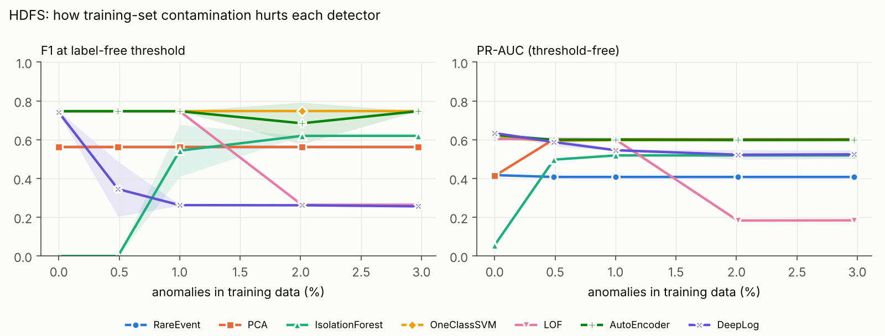
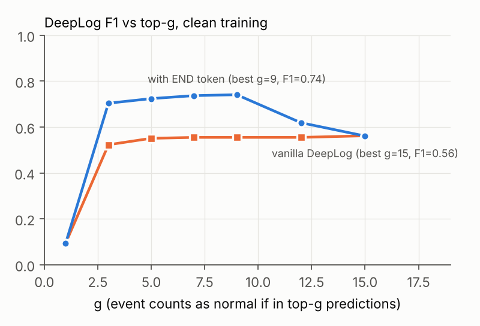

# Real-Time Anomaly Detection in System Logs using Unsupervised Learning

[](https://github.com/Aranya2801/Real-Time-Anomaly-Detection-in-System-Logs-using-Unsupervised-Learning/actions)

This project parses raw system logs into event templates, groups them into sessions, and flags
anomalous sessions without using labels for training. It also has a streaming mode that checks every
log line as it arrives, so you can find out about a problem before the session is finished.

Most log anomaly detection papers call their methods "unsupervised" but train them only on sessions
already known to be normal, and that takes labels. I wanted to know what happens when you don't have
that luxury and the training data contains some anomalies, which is what you get if you train on last
week's logs in a real system. That became the main experiment here.

## What's in here

- **Drain log parser** (`logsentinel/parsing/drain.py`): I wrote my own version from the original paper
  rather than using `drain3`, mainly so I understood it and could run it one line at a time. I checked it
  against the ground-truth templates for all 16 LogHub systems.
- **Seven detectors behind one interface** (`fit / score / predict`):
  - PCA with the Q-statistic threshold (Xu et al., SOSP'09)
  - Isolation Forest, One-Class SVM, LOF
  - an MLP autoencoder on event counts
  - DeepLog (Du et al., CCS'17), an LSTM next-event model, with one change I made (below)
  - a `RareEvent` rule I added as a sanity baseline
- **Label-free thresholds** for every model, so the F1 numbers reflect what you'd actually deploy. Best-F1
  over all thresholds is reported separately and clearly marked.
- **A streaming detector** (`logsentinel/stream.py`) that keeps per-session state and alerts on
  unseen templates, unexpected next events, or sessions that end too early.
- Experiment scripts that regenerate every number and figure in this README.

## Data

I used the HDFS dataset from [LogHub](https://github.com/logpai/loghub): Hadoop file-system logs where
each block id is a session and each block is labeled normal or anomalous. The results below come from
the 100k-line HDFS sample published by LogPAI, which has 7,940 blocks, 313 of them anomalous.
`scripts/download_data.sh --full` fetches the full 11M-line HDFS_v1 if you have the disk space and time.

Splits are **chronological**: the first 50% of blocks (by first appearance) for training, the rest for
testing. Random splits on HDFS put near-identical sessions on both sides and inflate scores.

One thing I found while digging into the data: **80 of the 195 anomalous test blocks have exactly the
same event sequence as some normal block.** The 100k sample covers only about 26 minutes of logging, so
for those blocks whatever made them anomalous happened outside the window. No session-level method can
catch them, so I also report recall on the remaining "distinguishable" anomalies.

## Results

All numbers come from `results/` and can be regenerated with the commands further down. Stochastic models
were run with 3 seeds, shown as mean ± std where the std isn't zero.

### 1. Clean vs. unlabeled training data

| model | F1, clean training | F1, unlabeled training (~3% anomalies) | PR-AUC clean → unlabeled |
|---|---|---|---|
| RareEvent rule | 0.562 | 0.562 | 0.417 → 0.408 |
| PCA | 0.562 | 0.562 | 0.413 → 0.602 |
| Isolation Forest | 0.000 | 0.620 | 0.055 → 0.519 |
| One-Class SVM | **0.747** | **0.747** | 0.609 → 0.599 |
| LOF | **0.747** | 0.264 | 0.603 → 0.184 |
| Autoencoder | **0.747** | **0.747** | 0.624 → 0.599 |
| DeepLog (+END token) | 0.741 ± 0.007 | 0.256 ± 0.001 | 0.634 → 0.524 |

F1 is measured at the label-free threshold. Every model that reaches 0.747 F1 finds **all** of the
distinguishable anomalies (recall 1.0 on that subset) with 0.975 precision. Full table with
precision, recall and ROC-AUC: [`results/RESULTS.md`](results/RESULTS.md).



What I take from this:

- **DeepLog is the most fragile.** At just 0.5% contamination its F1 drops from 0.74 to about 0.35, and
  by 1% it's at 0.26. HDFS has only ~20 event types, so once a few anomalous sessions are in the training
  data their events quickly end up in the model's top-9 predictions and stop counting as surprising.
- **LOF survives 1% contamination but falls apart at 2%**, once anomalies are dense enough to form
  their own neighbourhoods.
- **Isolation Forest does the opposite of what you'd expect:** it is useless on clean data. 60.5% of
  test anomalies differ from normal sessions in event types whose count never varies in the clean
  training set, and Isolation Forest can't split on a feature that doesn't vary. A little contamination
  gives those features some variance, so it starts working.
- **One-Class SVM is the robust one** here: 0.747 F1 at every contamination level and every seed. The
  autoencoder is close behind; one of its three seeds dropped to 0.56 at 2% contamination, otherwise it
  stays at 0.747.
- **PCA gets better with contamination** for a similar reason as Isolation Forest: the TF-IDF weighting
  in the original method zeroes out events that appear in every training session.

### 2. Breaking down what "detectable" means on HDFS

The RareEvent rule (flag a session if it contains a template seen in under 5% of training sessions)
reaches 0.395 recall with 0.975 precision without learning anything. Combined with the analysis above,
the test anomalies split roughly into:

| type | share of test anomalies | who catches it |
|---|---|---|
| contains an event normal sessions never produce | ~40% | everything, including the rule |
| missing events, i.e. the block stops early | ~21% | OCSVM, LOF, AE, DeepLog with END token |
| identical to a normal session within this window | ~41% | nobody, by construction |

So on this dataset, no detector does better than the rule plus a check for "is the session complete?".
I think that's worth stating plainly, because many papers report F1 above 0.95 on HDFS and it's hard
to tell how much of that is the method and how much is the setup.

### 3. DeepLog with an end-of-session token

Vanilla DeepLog only checks events that actually arrive, so a block that gets allocated and then goes
silent is never flagged. I added an `END` key that the model must predict when a session closes.

| | precision | recall | F1 | PR-AUC |
|---|---|---|---|---|
| vanilla DeepLog, clean | 0.937 | 0.395 | 0.555 | 0.432 |
| **with END token, clean** | 0.955 | **0.605** | **0.741** | **0.634** |
| vanilla DeepLog, unlabeled | 0.824 | 0.154 | 0.259 | 0.331 |
| with END token, unlabeled | 0.763 | 0.154 | 0.256 | 0.524 |

It's a one-line change in how the training windows are built and it moves clean F1 from 0.555 to 0.741.
It doesn't fix the contamination problem, though.



### 4. Streaming replay

`experiments/streaming_replay.py` takes the model trained on the first half and pushes the second half
of the log through `StreamingDetector` one line at a time:

| | value |
|---|---|
| throughput (single process, CPU, includes parsing) | ~3,500 lines/s |
| precision / recall | 0.967 / 0.605 (same as batch) |
| anomalies flagged before the block's last event | 24.6% |
| alert reasons | 57 unseen template, 41 ended early, 20 unexpected event |

The throughput is limited by running the LSTM once per event; batching events across sessions would be
the obvious next step. I also tried warming the model up only on lines from the stream before the cut
(`--warmup prefix`). That loses all the "ended early" detections (recall 0.395), because HDFS blocks stay
open for a long time (median about 5,500 lines) and most warm-up sessions look unfinished, so the model
learns that sessions can stop anywhere.

Some real alerts from the replay are in [`results/streaming_alerts_offline.txt`](results/streaming_alerts_offline.txt).

### 5. Parser accuracy

Grouping accuracy of my Drain implementation on the LogHub 2k samples (same masks and hyperparameters as
the LogPAI benchmark):

| HDFS | Hadoop | Spark | Zookeeper | BGL | HPC | Thunderbird | Windows |
|---|---|---|---|---|---|---|---|
| 0.998 | 0.949 | 0.922 | 0.967 | 0.964 | 0.900 | 0.950 | 0.997 |

| Linux | Android | HealthApp | Apache | Proxifier | OpenSSH | OpenStack | Mac |
|---|---|---|---|---|---|---|---|
| 0.235 | 0.894 | 0.863 | 1.000 | 0.526 | 0.731 | 0.722 | 0.791 |

These mostly line up with the numbers reported for Drain in Zhu et al. (ICSE-SEIP 2019). Linux is the
exception, and that's down to the ground truth: the current LogHub labels treat `user=root`,
`user=guest` and `user=test` as three different templates, and a similarity-based parser will (correctly,
I'd argue) merge them.

## Running it

```bash
git clone https://github.com/Aranya2801/Real-Time-Anomaly-Detection-in-System-Logs-using-Unsupervised-Learning.git
cd Real-Time-Anomaly-Detection-in-System-Logs-using-Unsupervised-Learning
pip install -r requirements.txt
./scripts/download_data.sh

export PYTHONPATH=.
python experiments/parser_benchmark.py            # ~5 s
python experiments/hdfs_benchmark.py --seeds 3    # ~15 min on a laptop CPU
python experiments/streaming_replay.py            # ~2 min
python experiments/make_report.py                 # tables + figures into results/
pytest -q
```

Train a model and stream a log file through it:

```bash
python -m logsentinel.train data/HDFS/HDFS_100k.log_structured.csv \
    --labels data/HDFS/anomaly_label.csv --out models/hdfs_deeplog.pkl
tail -F /var/log/hadoop/hdfs.log | python -m logsentinel.stream models/hdfs_deeplog.pkl
```

Leave out `--labels` to train fully unsupervised (and see section 1 for what that costs you).

## Layout

```
logsentinel/
  parsing/drain.py       Drain parser (online, one line at a time)
  parsing/settings.py    per-dataset masks / hyperparameters
  data.py                HDFS loading, block-id sessions, chronological split
  features.py            event count matrix (+ TF-IDF for PCA)
  models/classical.py    PCA, IsolationForest, OCSVM, LOF, RareEvent rule
  models/deep.py         DeepLog (+END token), autoencoder
  stream.py              streaming detector + CLI
  train.py               train & save a parser+DeepLog bundle
  metrics.py             grouping accuracy, PR-AUC, best-F1
experiments/             scripts that produce everything in results/
tests/                   unit tests (parser, every detector, streaming)
```

## Limitations / what I'd do next

- Everything is on the HDFS *sample*. The code handles the full HDFS_v1 file, but I haven't run the
  full sweep on it yet. BGL and Thunderbird need sliding windows instead of block ids, which I haven't
  added.
- The contamination results probably depend on how small the HDFS vocabulary is. I'd like to see
  whether DeepLog is as fragile on BGL, which has hundreds of templates.
- A robust variant of DeepLog (e.g. dropping training windows the model itself finds too surprising,
  and retraining) seems like the natural fix for the contamination problem. I haven't tried it yet.
- The streaming detector processes one event at a time per session; batching across sessions should
  give a large speedup.

## References

- P. He, J. Zhu, Z. Zheng, M. R. Lyu. *Drain: An Online Log Parsing Approach with Fixed Depth Tree.* ICWS 2017.
- W. Xu, L. Huang, A. Fox, D. Patterson, M. I. Jordan. *Detecting Large-Scale System Problems by Mining Console Logs.* SOSP 2009.
- M. Du, F. Li, G. Zheng, V. Srikumar. *DeepLog: Anomaly Detection and Diagnosis from System Logs through Deep Learning.* CCS 2017.
- J. Zhu et al. *Tools and Benchmarks for Automated Log Parsing.* ICSE-SEIP 2019.
- J. Zhu, S. He, P. He, J. Liu, M. R. Lyu. *Loghub: A Large Collection of System Log Datasets for AI-driven Log Analytics.* ISSRE 2023.
- S. He, J. Zhu, P. He, M. R. Lyu. *Experience Report: System Log Analysis for Anomaly Detection.* ISSRE 2016.

## License

MIT
